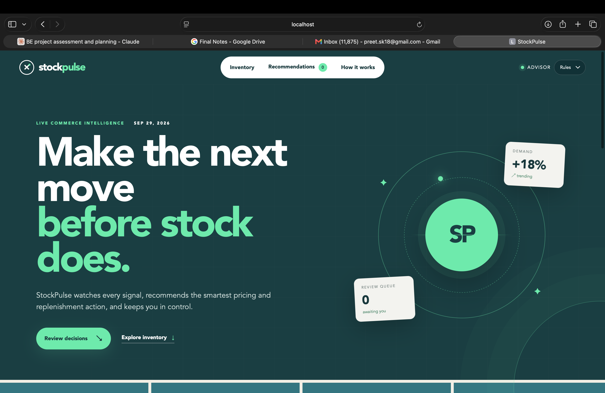
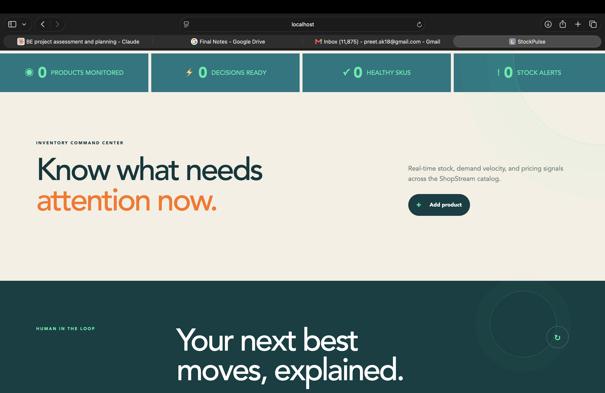
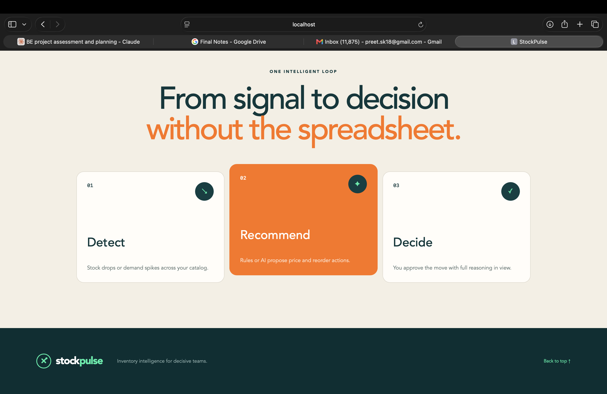
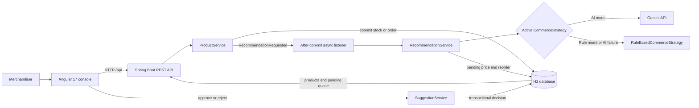

# StockPulse

**An AI-assisted inventory and pricing advisor for ShopStream.** StockPulse turns a sale or stock change into reviewable pricing and replenishment recommendations. It explains *why* each action is suggested and waits for a merchandiser to approve it before changing the product.

The core demo is deliberately simple: **simulate a sale → detect low stock or a demand spike → generate suggestions asynchronously → review the reasoning → approve or reject → see the product update.** The app runs locally with a file-backed H2 database, so judges do not need a separate database server.

## Product tour

### Live commerce intelligence

The dashboard keeps the active advisor mode, inventory signals, and recommendation count visible at a glance.

<p align="center">
  
</p>

### Inventory and human review

The inventory command center surfaces products that need attention, while the review queue keeps every pricing or replenishment change under human control.

<p align="center">
  
</p>

### The decision loop

StockPulse follows one focused workflow: detect an inventory signal, recommend an action, and let the merchandiser decide.

<p align="center">
  
</p>

## What judges can see

| Evaluation area | Weight in brief | Implemented evidence | Where to look |
| --- | --- | --- | --- |
| Domain and API | 20 | Products, pricing suggestions, reorder suggestions, validation, lifecycle statuses, and REST endpoints | [`domain/model`](backend/src/main/java/com/stockpulse/domain/model), [`ProductController`](backend/src/main/java/com/stockpulse/web/ProductController.java), [`SuggestionController`](backend/src/main/java/com/stockpulse/web/SuggestionController.java) |
| Commerce engine | 25 | A shared `CommerceStrategy` contract, deterministic price and reorder rules, and a runtime `RULE` / `AI` selector | [`commerce`](backend/src/main/java/com/stockpulse/commerce), [`StrategyController`](backend/src/main/java/com/stockpulse/web/StrategyController.java) |
| AI integration | 25 | Trigger-aware Gemini prompts, numeric output validation, bounded HTTP calls, and independent rule fallbacks for pricing and reorder | [`AiCommerceStrategy`](backend/src/main/java/com/stockpulse/ai/AiCommerceStrategy.java), [`LLMGateway`](backend/src/main/java/com/stockpulse/ai/LLMGateway.java) |
| Agentic loop | 15 | Stock/order events are handled asynchronously after the product transaction commits; pending suggestions are persisted and deduplicated | [`ProductService`](backend/src/main/java/com/stockpulse/service/ProductService.java), [`RecommendationEventHandler`](backend/src/main/java/com/stockpulse/service/RecommendationEventHandler.java), [`RecommendationService`](backend/src/main/java/com/stockpulse/service/RecommendationService.java) |
| Merchandising UI | 12 floor | Product watchlist, simulated sales, manual requests, trigger badges, confidence, reasoning, approval controls, polling, loading state, and unobtrusive console diagnostics | [`app.component.ts`](frontend/src/app/app.component.ts) |
| Architecture and walkthrough | 20 | Decision records, seeded demo data, and an end-to-end test | [`ADR.md`](ADR.md), [`seed migration`](backend/src/main/resources/db/migration-h2/V2__seed_demo_products.sql), [`AgenticLoopIntegrationTest`](backend/src/test/java/com/stockpulse/agentic/AgenticLoopIntegrationTest.java) |

The brief also offers optional points for a richer UI and SSE streaming. This build focuses on the complete inventory-signal-to-human-approval path; the deferred extensions are listed below. The weights describe the brief, not a self-assigned score.

## Tech stack

| Layer | Technology | Role |
| --- | --- | --- |
| Frontend | Angular 17, TypeScript 5.4, RxJS, CSS | Merchandising console and automatic queue refresh |
| API | Java 17, Spring Boot 3.3, Spring Web, Bean Validation | Product, suggestion, and strategy endpoints |
| Data and migrations | Spring Data JPA, H2 2.2, Flyway | Persistent local product and suggestion state; repeatable schema/seed migrations |
| AI | Gemini `gemini-2.5-flash` through the Gemini REST API; optional OpenAI-compatible gateway | Context-aware pricing and reorder recommendations |
| Reliability | Spring transactions, after-commit events, `@Async`, database uniqueness constraints | Fast sale response, persistent review queue, and duplicate-pending protection |
| Build and verification | Maven, npm/Angular CLI, JUnit 5, Mockito, Spring Boot Test | Backend tests and frontend production build |

### System architecture



### The approval loop

```mermaid
sequenceDiagram
    actor Merchandiser
    participant UI as Angular console
    participant API as Spring API
    participant DB as H2
    participant Worker as Async recommendation worker
    participant Advisor as Gemini or rules

    Merchandiser->>UI: Simulate sale
    UI->>API: POST /api/products/{id}/orders
    API->>DB: Decrease stock; increase velocity; commit
    API-->>UI: Updated product immediately
    API-->>Worker: After-commit recommendation event
    Worker->>Advisor: Request pricing and reorder advice
    Advisor-->>Worker: Validated advice or rule fallback
    Worker->>DB: Save pending suggestions
    UI->>API: Poll pending queue
    API-->>UI: Trigger, confidence, reasoning, suggested values
    Merchandiser->>UI: Approve or reject
    UI->>API: PATCH suggestion decision
    API->>DB: Apply accepted change in a transaction
    API-->>UI: Updated review state
```

## How decisions are made

1. A stock update or simulated order writes the product first. Orders reduce stock and increment the demo demand-velocity counter. Stock cannot become negative.
2. **Low inventory** fires when `stockLevel < reorderThreshold`. **Demand spike** fires when `demandVelocity > 2 × the current category average`.
3. An after-commit listener dispatches recommendation generation asynchronously, so the sale request does not wait for Gemini.
4. The active strategy returns a pricing recommendation and a reorder recommendation. Each has a trigger reason, confidence score, explanation, and `PENDING` status. Manual price and reorder buttons request only their respective suggestion type.
5. Before saving, the service checks for a pending suggestion with the same product, trigger, and type. H2 unique indexes provide another guard against duplicate pending rows.
6. The UI polls the product list and review queue every **2.5 seconds**. **Approve price** applies the recommended price. **Approve stock** adds the recommended quantity as a simulated inbound shipment. **Reject** leaves the product value unchanged. Decisions are persisted.

The deterministic rule strategy recommends a **10% price increase** for low stock, a **5% increase** for demand above twice the category average, or **HOLD** otherwise. Its reorder baseline is `max(1, reorderThreshold × 3 − stockLevel)`. The AI strategy receives product and trigger context, validates the model's JSON, and falls back to the relevant rule independently if a call times out, fails, or returns invalid values. A loaded key (`aiConfigured: true`) confirms configuration; the saved reasoning shows which recommendation was actually produced.

## Run locally

### Prerequisites

- **JDK 17** with `javac` (a JRE alone cannot compile the backend)
- **Maven 3** on `PATH`
- **Node.js and npm** suitable for Angular 17
- A browser; no external database installation is needed

Use **two terminals** from the project root. Ports **8080** (API) and **4200** (Angular) must be free. Flyway initializes H2 and seeds eight demo products on the first backend start. Later restarts keep the database at `backend/data/stockpulse.mv.db`.

### Windows PowerShell or Command Prompt

Terminal 1 — backend:

```powershell
.\start-backend.cmd
```

The launcher selects an installed JDK 17 when `JAVA_HOME` points to a JRE, loads the ignored `backend/.env.local` file if it exists, and runs Spring Boot. To use a JDK in another location, set `JAVA_HOME` to that JDK before starting the launcher.

Terminal 2 — frontend:

```powershell
cd frontend
npm.cmd ci
npm.cmd start
```

`npm.cmd` works in PowerShell environments that block `npm.ps1`. Open **http://localhost:4200**. Angular proxies `/api` requests to **http://localhost:8080**, so both terminals must remain running.

### macOS or Linux

Set `JAVA_HOME` to a JDK 17 installation, then run:

```bash
# Terminal 1
cd backend
mvn spring-boot:run
```

```bash
# Terminal 2, from the project root
cd frontend
npm ci
npm start
```

With no AI variables set, the backend starts in deterministic `RULE` mode. The API can be checked independently at **http://localhost:8080/api/products** and **http://localhost:8080/api/strategy**.

### Enable Gemini recommendations

The app works without an API key. For a live AI demo on Windows, copy [`.env.example`](.env.example) to `backend/.env.local`, put your own Gemini key in `LLM_API_KEY`, and restart the backend with `start-backend.cmd`. The file is excluded by [`.gitignore`](.gitignore); never put a real key in `.env.example` or commit it.

The relevant local values are:

```dotenv
COMMERCE_STRATEGY=ai
LLM_PROVIDER=gemini
LLM_BASE_URL=https://generativelanguage.googleapis.com
LLM_MODEL=gemini-2.5-flash
LLM_API_KEY=<your key>
```

On macOS/Linux, export these variables in the backend terminal before `mvn spring-boot:run`. The code also retains an OpenAI-compatible provider path for a separately configured gateway. The **Advisor** selector in the UI, or `PUT /api/strategy` with `{"mode":"AI"}` / `{"mode":"RULE"}`, can switch modes while the backend is running. A restart restores `COMMERCE_STRATEGY` from the environment.

## Judge walkthrough: verify the website flow

Use a **new product** for a predictable demo; existing data persists between runs. These steps need no terminal commands after both servers start.

| Step | Action in the website | What to verify |
| --- | --- | --- |
| 1 | Open **http://localhost:4200**. Select **Rules** for the first pass so the expected values are deterministic. | The product watchlist loads, with stock, price, demand velocity, and status. |
| 2 | Click **Add product**. Enter a unique SKU such as `DEMO-001`, name `Demo T-Shirt`, category `APPAREL`, price `20`, stock `5`, and reorder threshold `5`. | The new card shows `$20.00` and `5 / 5 min`. Stock is at, not below, the trigger threshold. |
| 3 | Click **Simulate sale** once on that card. | Stock becomes `4`, demand velocity rises by one, and the product moves into review status. The sale response arrives before advice generation finishes. |
| 4 | Watch the **Review queue**; it refreshes automatically. Allow extra time for a live model call, or click **Refresh queue**. | A pricing suggestion and a reorder suggestion appear with `INVENTORY_LOW`, confidence, and plain-English reasoning. Neither has changed the price or replenished stock yet. |
| 5 | Read the recommendation, then click **Approve price**. | In Rules mode, the low-stock rule raises `$20.00` to `$22.00`. The pricing card leaves the pending queue. |
| 6 | Click **Approve stock** on the reorder card. | On-hand stock increases by the recommended quantity; the reorder card leaves the pending queue. |
| 7 | Click **Suggest price** or **Suggest reorder** for a manual request. Reject one of the resulting `MANUAL` suggestions. | The rejected suggestion leaves the pending queue without changing the corresponding product value. |

The eight seed products offer extra scenarios: **PRD-003** (Organic Cotton T-Shirt) starts below its reorder threshold, and **PRD-008** (Hoodie) has elevated demand velocity. Their state may change after a previous demo, so the new-product path above is the most repeatable. You can remove the temporary demo product through its card; removal also deletes its suggestion history.

For the **live AI pass**, switch Advisor to **AI** and use **Suggest price** and **Suggest reorder** on a product. Compare the model's reasoning and confidence with the fixed rule wording. Gemini may recommend `HOLD`; approving a hold correctly leaves the price unchanged. If a model call fails validation or transport, the rule fallback still creates a reviewable suggestion.

## API map

All routes are under `/api`. The UI calls these same endpoints through Angular's proxy.

| Method | Route | Purpose |
| --- | --- | --- |
| `GET` / `POST` | `/products` | List/filter products or create one |
| `GET` / `DELETE` | `/products/{id}` | Read or remove a product |
| `PATCH` | `/products/{id}/stock` | Set absolute stock quantity and check triggers |
| `POST` | `/products/{id}/orders` | Simulate an order; decrease stock and increase velocity |
| `POST` | `/products/{id}/suggest-pricing` | Queue a manual pricing suggestion |
| `POST` | `/products/{id}/suggest-reorder` | Queue a manual reorder suggestion |
| `GET` | `/pricing-suggestions`, `/reorder-suggestions` | Read pending review queues |
| `PATCH` | `/pricing-suggestions/{id}`, `/reorder-suggestions/{id}` | Accept or reject a pending suggestion |
| `GET` / `PUT` | `/strategy` | Inspect or switch the active recommendation mode |

For example, `GET /api/strategy` returns the mode and whether a key is loaded. The request body for either decision endpoint is `{"status":"ACCEPTED"}` or `{"status":"REJECTED"}`. Invalid requests return structured errors; missing products return `404`, and stock conflicts or finalized suggestions return `409`.

## Verification and project structure

Run the backend suite with JDK 17 selected:

```text
cd backend
mvn test
```

Build the frontend:

```text
cd frontend
npm run build
```

On Windows, use `mvn.cmd` and `npm.cmd` if PowerShell blocks their `.ps1` shims. The latest backend package run completed **51 tests with no failures** across domain rules, AI fallback, deduplication, persistence, and the HTTP order-to-approval integration path. A production Angular build is the frontend check. Live Gemini pricing and reorder requests have also been exercised through the backend with temporary products removed afterward.

| Path | Contents |
| --- | --- |
| `backend/src/main/java/com/stockpulse` | Domain, API, commerce strategies, AI gateway, services, repositories |
| `backend/src/main/resources/db/migration-h2` | H2 schema, constraints, indexes, and eight seed products |
| `backend/src/test` | Unit, repository, and integration tests |
| `frontend/src` | Angular console and styling |
| `ADR.md` | Architectural decisions, alternatives, and tradeoffs |
| `stockpulse-brief 1 (1).html` | Original hackathon brief |

## Scope and tradeoffs

StockPulse is a **decision-support prototype**, not a storefront or an automated purchasing system. The velocity value is a demo counter increased by simulated orders, rather than a rolling 24-hour metric. The async worker runs inside the Spring process; a production deployment would add a durable queue, retries, monitoring, authentication, and a proper time-windowed demand signal. Competitor prices, margin floors, supplier catalogs, automated purchase orders, advanced analytics, and SSE are deferred. The seams for those additions are the `CommerceStrategy` contract, response validation, and product/suggestion persistence; the choices are explained in [`ADR.md`](ADR.md).

## Troubleshooting

| Symptom | Check |
| --- | --- |
| Maven says no compiler is available | `JAVA_HOME` points to a JRE. Select a JDK 17 installation containing `bin/javac` and restart the backend terminal. |
| Port 8080 or 4200 is already in use | Stop the older backend or frontend process before starting another copy. |
| The catalog stays empty | Start the backend first; the Angular proxy in `frontend/proxy.conf.json` targets port 8080. Request failures are logged in the browser developer console without interrupting the main screen. |
| A sale produces no new queue card | Wait for the async call and refresh. Stock must be **below** the threshold, and an existing pending suggestion for the same product and trigger is intentionally reused. A new unique demo SKU gives a clean path. |
| Advisor says AI but the reasoning matches a rule | AI mode can fall back when the key, gateway, model output, or validation fails. Check `GET /api/strategy` for mode/configuration and the backend log without printing the key. |
| Seed products look different from the walkthrough | H2 persists changes across restarts. Use the new-product demo path; preserve the database file if you need its history. |

## Submission checklist

- [x] Source code, runnable local demo, seed data, tests, and architecture decision record
- [x] README with setup, architecture, API map, and an end-to-end judge walkthrough
- [ ] Publish the repository publicly without `backend/.env.local`, local database files, build output, or downloaded JDK archives
- [ ] Record a five-minute demo: problem and architecture → sale trigger → async suggestions → approval updates → AI fallback and ADR tradeoffs
